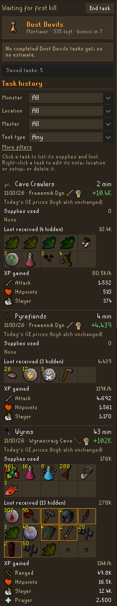
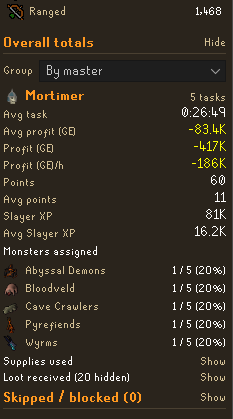
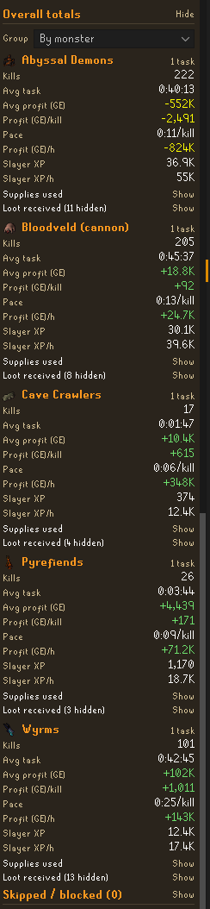

# Slayer Ledger

Slayer Ledger is a RuneLite plugin that keeps a record of your Slayer tasks. It starts tracking on your first kill of a task, with nothing to press. It counts your kills, active time, loot, supplies and XP, notes how you did the task (cannon, attack style, gear) and where, and saves the task to a local history when you finish it.

When a master gives you a new task, it looks at your own completed tasks of that monster and tells you which setup has done it best, how long the kills left should take and what to bring.

It only reads the game. It never plays, clicks, skips or blocks anything for you.

<!-- screenshot: the sidebar with a live task running (status strip, live task card with its setup tags, progress bar and stats, supplies and loot grids) -->

For exactly what each feature counts and its edge cases, see [Counting rules and details](docs/COUNTING_RULES.md).

## New in 2.0

If you used Slayer Ledger 1.x, this is what changed.

- **Tracking starts by itself.** There is no Play button. Your first kill on a task starts the session, timed from your first hit on that monster. A world hop no longer pauses it. Logging out stops the clock, and your next task kill after logging in starts it again.
- **Your history is migrated.** Your saved tasks, notes, location names, Skipped / blocked entries and settings carry over. Reading them changes nothing: the file is rewritten in the 2.0 format the next time it changes anyway (a task saved, edited or deleted, or a skip or block recorded).
- **Setup tags.** Every task now has a Cannon, Style and Gear tag, detected from your kills. Tasks saved by 1.x get estimated tags, shown with `~`: Cannon from the cannonballs they fired, Style from the XP they gained. Their Gear is Unknown, because 1.x kept no equipment. You can change any tag.
- **Locations are automatic.** The plugin names the place from a bundled list of Slayer spots. The **Name this location** box is gone; the names you gave in it are still used.
- **The advisor** replaces the History estimate, What to bring and the new-task chat preview. It is a card in the sidebar and one chat line when a task is assigned.
- **Removed:** Trends and its charts, the Luck meter, the History estimate, What to bring, the location naming prompt and the "Not tracking" reminder, with their settings. The Task advisor goal setting is gone too: the **Advisor metric** replaces it.
- **Overlay settings.** The overlay's rows are now four groups, each with one setting: Progress and identity, Pace, Haul and Supply runway. Your 1.x **Show task row** carries over to Progress and identity, and **Show profit row** to Haul.
- **No way back.** Once 2.0 has saved your tasks, 1.x can still show them but can't save new ones to that file. Don't switch back to 1.x on that account.

## Features

### Tracking

Tracking is automatic. The status strip at the top of the sidebar always says what it is doing:

- **Running**, with the elapsed time (`21:54`).
- **Waiting for first kill**: a task is assigned and you haven't killed one yet.
- **Away**: no task kill and no hit on your task monster for 10 minutes (the **Away after** setting).
- **Paused**: you pressed Pause.
- **Logged out**, then **Waiting for next kill** once you log in again.
- **Ended**: you pressed End task.
- **No task.**

Beside it are only the buttons that apply: **Pause** while running, **Resume** while paused, **End task** while there is a task to end, and **Track again** once it is Ended.

How it works:

- **Start.** Your first task kill starts the session. Its time goes back to your first hit on the monsters that died around that kill, so the whole first fight counts, a boss fight too. Supplies used in the 3 minutes before, such as a pre-pot or a teleport to the task, count with it.
- **Hop.** The clock keeps running.
- **Logout.** The clock stops at once. After you log in, one chat line says `Slayer Ledger: waiting for your next kill`, and your next task kill starts it again. Logged-out time never counts. A session also survives a client restart.
- **Away.** The time stops at your last kill or hit, so the clock steps back once, and what you used and gained since then is taken back. A bank trip shorter than the limit counts as task time. Your next task kill starts the clock again.
- **Pause and Resume.** Pause stops the clock. Resume, or your next task kill, starts it again.
- **End task.** Saves an unfinished task as `Partial` (it asks first if **Confirm before saving incomplete tasks** is on). Nothing on that assignment is tracked until you press **Track again**.
- **Jad and Zuk.** The time inside the Fight Caves or the Inferno is task time. Going in starts the clock, and leaving stops it.
- **Completion.** A finished task is saved by itself.

### Supplies, loot and XP

- **Supplies:** food, potion doses, runes (inventory and rune pouches), ammo less what Ava's or picking up brings back, cannonballs (regular and granite), Slayer consumables, teleport tablets and scrolls, jewellery and Slayer bracelet charges, and estimated blowpipe, trident, Sanguinesti staff and Tumeken's shadow use.
- **Loot:** what your kills drop, from the same data as RuneLite's Loot Tracker. Bonecrusher and ash sanctifier handling and an ignore list are in the settings. Items on the Ground Items plugin's hidden list are left out of the loot icons and, except coins, the loot value (a setting).
- **XP:** every skill you gain XP in during the session.
- **Values:** loot at GE price or high alch (a setting), supplies at GE price. Every saved task is valued at today's prices, so tasks done months apart compare fairly.
- **Also recorded:** superiors, bank trips, deaths, the Slayer master, task type, Slayer points earned, your streak and the next bonus task, boss kill counts, Slayer keys, clue scrolls and notable drops (pets included).

The live task card shows the supplies and loot as item icons, like RuneLite's Loot Tracker, and the XP by skill.

### Setup tags

Each task has three tags:

- **Cannon:** Yes or No. Yes when at least half of the task's kills were made while your cannon fired.
- **Style:** Melee, Ranged, Barrage, Magic or Mixed. The style of at least half of your kills, from the weapon you held and the spells you cast. Barrage covers Ancient Magicks bursts and barrages. Mixed means no style did most of the work.
- **Gear:** Prayer, Strength or Mixed, from the prayer bonus of what you wear at each kill: +25 or more is Prayer, +14 or less is Strength.

A tag is Unknown when there was nothing to tell it from, for example a task done only with a cannon has no style.

The live task card shows the tags as small game icons. Click one to choose its value: the first choice, `Detected: ...`, uses what the plugin detected, and the others set the tag yourself. A tag you set has a small orange mark. For a saved task, right-click it in the history and choose **Setup…**. A value you set always wins, in the history filters and in the advisor.

### Variants, bosses and locations

- **Catacombs variants.** A task done on its Catacombs of Kourend variant is told from the standard monster by the monsters you kill, for example Deviant spectres on an Aberrant spectres task.
- **Slayer bosses.** A task done on its boss is named after it, for example Grotesque Guardians on a gargoyle task. A few boss kills on an ordinary task show as `Cave kraken + boss`.
- **Locations.** The place is named by itself, from a bundled list of Slayer spots: the spot where most of the task's kills happened. So the Catacombs of Kourend is told from the Stronghold Slayer Cave, and the Alchemical Hydra's lair from the Karuulm Slayer Dungeon around it. A place the list doesn't have shows as `Region N` until you rename it. To rename one task's location, right-click it and choose **Edit location**. For a place the list doesn't have, **Rename place (all its tasks)** names it for every task there.
- **Cannon tasks.** A task whose Cannon tag is Yes is listed as, for example, `Dust devils (cannon)`, apart from your Dust devils tasks without a cannon, so the cannonball costs and faster kills don't mix with them. This applies in the history, its Monster filter and Overall totals By monster. A Catacombs variant is likewise its own monster there (`Deviant spectres`, apart from `Aberrant spectres`), and a cannon task on a variant is `Deviant spectres (cannon)`.

### Advisor

When a task is assigned, the advisor groups your completed tasks of that monster by setup: spot, cannon or not, attack style, and whether you fought the boss. It picks the best setup by the **Advisor metric**:

- **Fastest finish** (the default): the least time for the kills left.
- **Profit per hour.**
- **Cheapest:** the least supply cost for the kills left.

Only a setup with at least 3 tasks can win. When none has 3, the one with the most tasks wins and says so (`based on 1 task`), so one lucky task doesn't decide.

**Chat line.** One line when the task is assigned, for example:

`Dust devils x142: barrage, Catacombs, ~24 min; ~440 death, ~220 blood (3 tasks). Cannon, Smoke Dungeon: ~41 min (2).`

It names the setup and its spot, then its time for the kills left, the two most valuable items to bring, the number of tasks it is based on, and the best setup with the other cannon choice.

**Advisor card.** In the sidebar, below the live task. It shows the recommendation and the best setup with the other cannon choice, one above the other. Each has:

- the time for the kills left, with a range;
- Slayer XP per hour and profit per hour;
- the supply cost;
- the gear most of its tasks used;
- the items to bring as icons, with safe amounts (more than a typical task needed).

Tabs switch the metric. **More setups** lists the rest. The card is open from the assignment to your first kill, then folds to one line, for example `Plan: barrage, ~1 h (3 tasks)`. Click it to open it again.

With no completed task of the monster, the card says `No completed Dust devils tasks yet, so no estimate.`

**Consider skip / Consider block.** Shown under the card's title, for a task that ranks near the bottom of your own monsters by Slayer XP per hour (by profit per hour when the metric is Profit per hour or Cheapest). It needs at least 3 tasks and 30 minutes on the monster, and 6 such monsters to compare. It is advice only.

<!-- screenshot: the advisor card open on a new task, showing the recommendation, the other cannon choice and its Bring icons -->

### Task history

Your saved tasks, newest first, 25 at a time, two lines each:

- the task's icon, name and active time;
- the date, the location's short name, the setup tag icons and the profit.

A task saved before it was finished says `Partial`.

- **Filters:** Monster, Location, Master and Task type, and Cannon, Style and Gear under **More filters**. They combine. **Clear filters** resets them.
- **Details:** hover over a task for its details. Click it to see its supplies, loot and XP item by item.
- **Edit:** right-click a task to edit its note, location or setup tags, or to delete it.

### Overall totals

Totals for all your completed tasks: task count, active time, profit and XP, with the supplies used and loot received as item icons. Choose a grouping:

- **Overall** and **By month**;
- **By monster:** kills, average task, profit per kill and per hour, pace and Slayer XP for each monster;
- **By master:** averages, profit per hour, Slayer points and Slayer XP for each master, and how often it assigned each monster, skips and blocks included.

Every group shows the same lines in the same order, with the number of tasks it covers (`3 tasks`).

### Skipped / blocked

Assignments that ended without a session: **Skipped**, **Blocked**, **Reset** (a Turael or Spria streak reset), **Completed (untracked)** or **Ended**. Each entry shows the task's icon, the monster, how it ended, the date and the master. These never count as played tasks. They only show up in By master's list of monsters assigned.

### Overlay

A compact on-screen box in the game's own style. It uses your RuneLite overlay colour and Interface font, and can be moved and resized. From top to bottom:

- **State line**, whenever time isn't running, for example `Away` / `Back on your next kill` or `Paused` / `Resume in sidebar`.
- **Progress and identity:** the task's icon and name, its spot and setup tags as small icons, a progress bar (`73 / 201`), the kills left and the time left. Until the session's own pace is reliable (3 kills and a minute of active time), the time left comes from your earlier completed tasks of the monster, at the same spot first.
- **Pace:** time per kill, kills per hour and elapsed time.
- **Haul:** superiors, profit and XP, and one line for about 10 seconds after a superior spawns (`Superior spawned.`).
- **Supply runway:** when a supply you carry will run out before the task ends at your rate (this task's from its 10th kill, your completed tasks' before that), for example `Prayer: ~40 kills` beside the item's icon. Within 9 kills it turns Bold (`Prayer: 6 left`), and it shows `Prayer: 0 left` once you have none. It covers prayer, restores, food, cannonballs, runes, ammo, and a toxic blowpipe's darts and scales (once you *Check* it).

Each group can be turned off. The state line can't, so a stopped clock is never silent.

<!-- screenshot: the overlay in game during a task, with a supply runway warning showing -->

### Chat lines

Short lines in your chat colours, facts first. Every line except the waiting line has its own setting.

- **Task complete:** `Dust devils done: 201 kills in 1 h 1 min, +412K. Gz.`
- **Record task**, when it was your fastest of that monster per kill, against at least 3 earlier tasks with the same variant and cannon use: `Fastest Dust devils task yet: 52 min, 4 min under your old best.`
- **Notable drop:** `Dragon chainbody (148K) from a dust devil.` or `Abyssal whip (1.4M) at kill 140 of 201.` The first drop in a task that covers the supplies used so far adds `That's the task paid for.`
- **Advisor:** the line above, when a task is assigned.
- **Waiting:** `Slayer Ledger: waiting for your next kill`, after you log in with a session waiting. This one is always on.

## Settings

The plugin's configuration has these sections:

- **Tracking:** Confirm before saving incomplete tasks; Bonecrusher handling (Auto, Always exclude, Never exclude); Ignored loot (names, `*` wildcards or item ids, separated by commas); Away after (1 to 60 minutes, default 10).
- **Values:** Loot price (GE or High alch; supplies are always at GE); Notable drop value (default 100,000 gp); Hide Ground Items' hidden items (on by default; see [Counting rules](docs/COUNTING_RULES.md#ground-items-hidden-items)).
- **Chat:** Task-complete line, Record task line, Notable drop line and Advisor chat line (all on by default); Task-complete notification, a RuneLite notification with the task-complete line's text (off by default).
- **Task overlay:** Show task overlay, and the four groups: Progress and identity, Pace, Haul and Supply runway. All on by default.
- **Task advisor:** Task advisor turns the Consider skip / Consider block advice on or off. Advisor metric: Fastest finish (default), Profit per hour or Cheapest. The advisor card's tabs change the same setting.
- **Panel sections:** hide Overall totals or Skipped / blocked if you don't use them.
- **Charged weapons:** Ranging/max cape has Vorkath's head upgrade, for blowpipe dart estimates.

Settings that still exist keep the values you chose.

## Your data

Everything stays on your computer. Saved tasks and the session in progress are stored per account in RuneLite's plugin data folder, `~/.runelite/plugin-data/slayer-ledger/`. Your names for places and your blowpipe's dart type are kept in RuneLite's per-account settings. The plugin sends nothing anywhere: item values come from RuneLite's own price data, and the bundled Wiki data is read from the plugin itself, never downloaded.

## Known limitations

- While the clock is stopped, what you use and gain is held back. Only part of it counts at the next start: XP and loot from your first hit on the monsters of that kill, and supplies from 3 minutes before. A short unrelated fight while the clock runs still counts its loot, XP and supplies (pause for it). One longer than the Away limit is taken back.
- A session starts on a task kill your client sees: a drop in the task count, or a bracelet of slaughter's message. A kill in the few seconds while the plugin restores your last session after a login doesn't start one.
- The time goes back to your first hit only on the monsters that died around the kill. A kill made only by your cannon starts the clock at the kill.
- Setup tags for tasks saved by 1.x are rough estimates from their XP and cannonballs.
- Blowpipe, trident and staff use is an estimate from average rates, and some charged items (for example the toxic staff of the dead and serpentine helm) are not tracked. See [Supplies not counted](docs/COUNTING_RULES.md#supplies-not-counted).
- An item whose GE price RuneLite hasn't loaded yet is left out of totals, which are then marked `~`.
- Older tasks saved without their items (only totals) can't be valued at today's prices. They keep their saved totals, marked `~`.
- Whether a task was extended is not recorded.
- Some game messages and values the plugin reads (for example several Slayer masters, pet messages, the skipped and blocked signals, and parts of the setup detection) have not all been checked in game yet.

Each feature's full list of limitations is in [Counting rules and details](docs/COUNTING_RULES.md).

## Credits and licence

Slayer Ledger is by Shmayvan, under the [BSD 2-Clause License](LICENSE).

- The task icon table is adapted from RuneLite's Slayer plugin by Tyler and Shaun Dreclin.
- The Slayer spot list (each spot's name, the tasks done there and the map regions computed from its monsters' spawn points) and the Slayer boss table (each Slayer boss, the tasks it is fought on and the superior monsters' names) are from the [Old School RuneScape Wiki](https://oldschool.runescape.wiki/) by Old School RuneScape Wiki contributors, under [CC BY-NC-SA 3.0](https://creativecommons.org/licenses/by-nc-sa/3.0/). The spot list's coordinates were checked against, and relocated Wiki map pins translated with, the NPC spawn and transport data of [mejrs/data_osrs](https://github.com/mejrs/data_osrs), and a few region ids were derived from it (the Dagannoth Kings' lairs and three Stronghold of Security floors; the spots that rest on it cite it); none of its records are copied.
- The Slayer master pictures are © Jagex Ltd.

## For developers

Requires Java 11. `./gradlew build` compiles the plugin and runs the tests; `./gradlew run` starts a RuneLite development client with the plugin loaded. The plugin is built against RuneLite 1.13.6; add `-PruneLiteVersion=latest.release` to build against the newest release.
