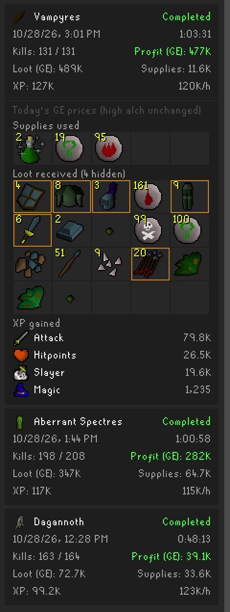
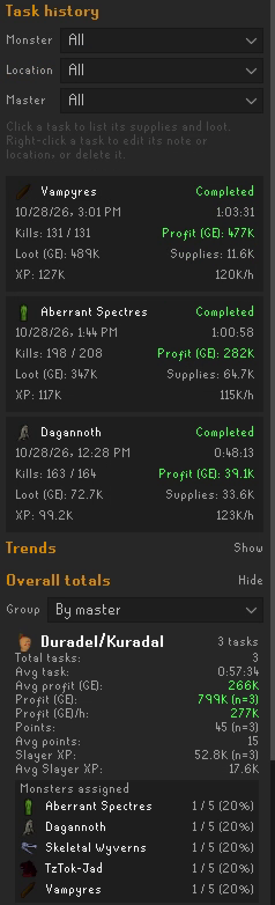

# Slayer Ledger

Slayer Ledger is a RuneLite plugin that keeps a record of your Slayer tasks. Start a session from its sidebar panel and it counts your kills, active time, loot, supplies and XP for the current task, then saves the task to a local history. From that history it estimates how long your next task will take, what to bring and what it is worth, and shows trends, totals and advice across all your tasks. It only reads the game: it never plays, clicks or skips anything for you.

For exactly what each feature counts and its edge cases, see [Counting rules and details](docs/COUNTING_RULES.md).

## Features

- **Tracking and sessions.** Press **Play** to start a session for your current task, **Pause** and **Resume** as you go, and **Stop** to save it (an unfinished task is saved as partial, after asking if you like). A completed task is saved automatically. Sessions never start or resume by themselves: logging out or hopping worlds pauses a running session, the overlay shows **Paused**, and one chat line tells you to press Resume. A session survives logouts and client restarts and comes back paused if your task is unchanged.
- **Loot, supplies and XP.** Counts the loot from your kills (with optional bonecrusher and ash sanctifier handling and an ignore list), the supplies you use (food, potion doses, runes, ammo, cannonballs, teleports, jewellery charges, and estimated blowpipe and trident use) and the XP you gain in every skill. The panel shows loot, supplies and profit as you go, with the items as icons, like RuneLite's Loot Tracker. Items on the Ground Items plugin's hidden list are left out of the loot icons and, except coins, the loot value (you can turn this off).
- **Task details.** Also records superiors, bank trips, deaths, the Slayer master, task type, Slayer points earned, your streak and the next bonus task, boss kill counts, Slayer keys, clue scrolls and notable drops (including pets).
- **Task history.** Lists your saved tasks, newest first, 25 at a time, with **Monster**, **Location** and **Master** filters that combine. Hover over a task for its details, or click it to see its loot, supplies and XP item by item. Right-click a task to add a short note (for example `Barrage` or `Cannon`), change its location, or delete it. Every saved task is valued at today's GE prices (high alch values don't change), so tasks done months apart compare fairly.
- **Task locations.** Records where you killed each task by map region. You name each region once (with suggestions from the OSRS Wiki's task locations), so the same monster in two places can be told apart.
- **Catacombs variants.** Tells a task done on its Catacombs of Kourend variant (for example Deviant spectres on an Aberrant spectres task) from the standard monster, automatically from the monsters you kill. The task box and the overlay show the variant, and the history, estimates and trends treat it as its own monster.
- **Cannon tasks.** A task in which you fired any cannonballs counts as a cannon task, worked out from the supplies used, also for tasks saved earlier. It is shown as, for example, `Dust devils (cannon)` in the task box, overlay, history and trends, apart from your tasks without a cannon, and the History estimate switches to your cannon tasks once you fire a cannonball (when you have completed any).
- **Estimates and What to bring.** When a task is assigned, the panel shows how long it took you before and what it earned, preferring tasks at the same location. **What to bring** suggests supplies and bank trips for the kills left, from what you used before. While a session runs, the panel shows the time left at your current pace.
- **Trends.** Ranks your monsters by profit per hour, profit per kill, Slayer XP per hour or points per hour, or charts one monster's rates task by task to see how your setup changed over time.
- **Overall totals.** Task count, active time, profit and XP for all your completed tasks, or by month, with the supplies used and loot received as item icons. **By monster** shows each monster's kills, average task, profit per kill and per hour, and Slayer XP; **By master** shows each master's averages, profit per hour, points and Slayer XP, and how often it assigned each monster, skipped and blocked tasks included.
- **Luck meter.** Compares how many of selected drops you got with how many you'd expect from your kills, for a few common Slayer monsters.
- **Task advisor.** Suggests **Consider skip** or **Consider block** for a task that ranks near the bottom of your own monsters by your chosen goal (profit, Slayer XP or points per hour), once you have enough data, and for a task with a Catacombs variant, which version has been better for you, and whether it has been better with a cannon or without. It is advice only.
- **Overlay.** A small on-screen box with the task, kills left, session kills, time left and profit, plus a **Paused** or **Not tracking** row when a task kill isn't being counted.
- **Chat lines.** A summary when a task is completed and saved, a one-line preview of a newly assigned task from your history, and a reminder the first time a task kill goes untracked.
- **Skipped / blocked log.** Records assignments that ended without a session (skipped, blocked, reset, completed untracked or ended) so your history covers every task you were given. These never count as played tasks.

## Settings

The plugin's configuration is grouped into sections:

- **Tracking**: Confirm before saving incomplete tasks, Bonecrusher handling (Auto, Always exclude, Never exclude), Ignored loot (names, `*` wildcards or item ids, separated by commas) and Ask again about skipped places.
- **Values**: Loot price (GE or High alch; supplies are always valued at GE), Notable drop value (default 100,000 gp) and Hide Ground Items' hidden items (on by default: the items on the Ground Items plugin's hidden list are left out of the loot icons and, except coins, out of loot value and profit everywhere, saved tasks included, while that plugin is on; your saved loot is kept, so turning it off or editing the list brings the values back. Ground Items' built-in list hides coins and bones, and coins still count in the value; see [Counting rules](docs/COUNTING_RULES.md#ground-items-hidden-items)).
- **Chat**: Task-complete notification (a RuneLite notification, off by default; the chat summary is always shown) and New-task chat preview (on by default).
- **Task overlay**: show or hide the overlay and each of its rows.
- **Task advisor**: turn the advisor on or off and choose its goal (Profit/h, Slayer XP/h or Points/h).
- **Panel sections**: hide What to bring, Trends, Overall totals, Luck meter or Skipped / blocked if you don't use them.
- **Charged weapons**: Ranging/max cape has Vorkath's head upgrade, for blowpipe dart estimates.

Settings saved by earlier versions are kept.

## Your data

Everything stays on your computer. Saved tasks are stored per account in RuneLite's plugin data folder, `~/.runelite/plugin-data/slayer-ledger/`, with region names, skipped regions and your blowpipe's dart type kept in RuneLite's per-account settings. The plugin sends nothing anywhere: item values come from RuneLite's own price data, and the bundled Wiki data is read from the plugin itself, never downloaded.

## Known limitations

- Only kills, loot, supplies and XP while a session is **running** count. Kills while paused or before you press Play are not counted, and loot from any NPC you kill while running is counted, so pause for unrelated fights.
- Blowpipe and trident use is an estimate from average rates, and some charged items and powered staves (for example the sanguinesti staff) are not tracked.
- An item whose GE price RuneLite hasn't loaded yet is left out of totals, which are then marked `~`.
- Older tasks saved without their items (only totals) can't be valued at today's prices: they keep their saved totals, marked `~`.
- Whether a task was extended is not recorded, and the luck meter covers only selected drops for a few monsters.
- Some game messages and values the plugin reads (for example several Slayer masters, pet messages and the skipped/blocked signals) have not all been checked in game yet.

Each feature's full list of limitations is in [Counting rules and details](docs/COUNTING_RULES.md).

## Credits and licence

Slayer Ledger is by Shmayvan, under the [BSD 2-Clause License](LICENSE).

- The task icon table is adapted from RuneLite's Slayer plugin by Tyler and Shaun Dreclin.
- The luck meter's drop rates and the suggested task location names are from the [Old School RuneScape Wiki](https://oldschool.runescape.wiki/) by Old School RuneScape Wiki contributors, under [CC BY-NC-SA 3.0](https://creativecommons.org/licenses/by-nc-sa/3.0/).
- The Slayer master pictures are © Jagex Ltd.

## For developers

Requires Java 11. `./gradlew build` compiles the plugin and runs the tests; `./gradlew run` starts a RuneLite development client with the plugin loaded. The plugin is built against RuneLite 1.13.4; add `-PruneLiteVersion=latest.release` to build against the newest release.
